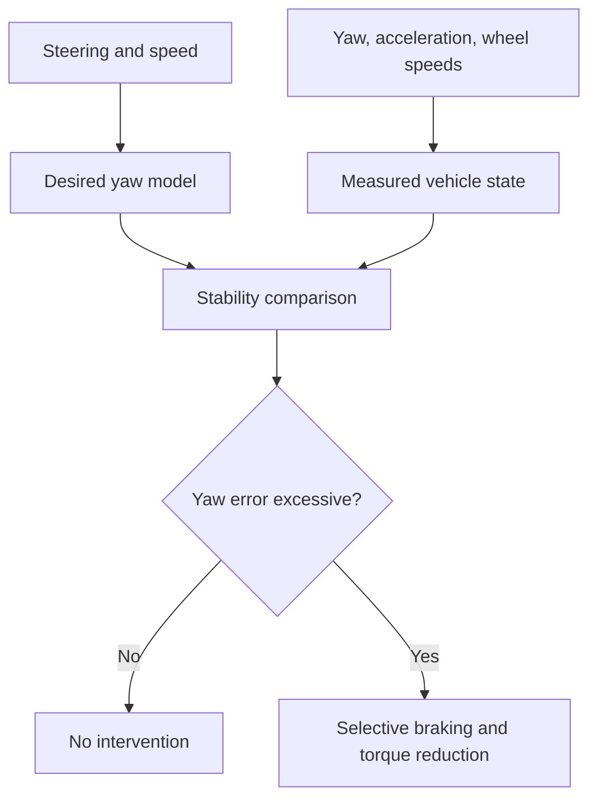
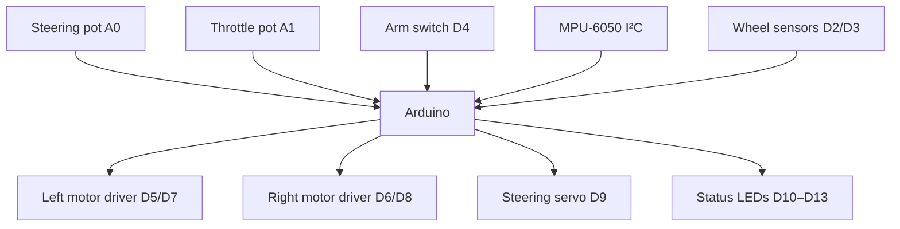

# Arduino ESP-Like Stability Controller

An educational Electronic Stability Control demonstration for a low-speed Arduino RC/robot car.

The project compares the yaw motion requested by the steering input with the yaw motion measured by an MPU-6050—or generated by the built-in bench simulator. When the mismatch becomes large, the controller reduces total motor torque and selectively reduces the left or right motor command to create a corrective yaw moment.

**Author:** John Stratakis<br>
**Website:** [med-physics.com](https://med-physics.com)

> [!CAUTION]
> This is a teaching and model-car project, not automotive-grade safety software. It must never be connected to a road vehicle's CAN bus, ABS/ESC module, hydraulic brakes, steering, accelerator, powertrain, or safety systems. Test with a small model car, initially with its driven wheels raised, and then only at walking speed in a clear area.

## Contents

- [What ESP does in a real car](#what-esp-does-in-a-real-car)
- [What this Arduino project demonstrates](#what-this-arduino-project-demonstrates)
- [Features](#features)
- [Operating modes](#operating-modes)
- [Control method](#control-method)
- [Understeer and oversteer response](#understeer-and-oversteer-response)
- [Hardware](#hardware)
- [Wiring](#wiring)
- [Installation](#installation)
- [Configuration](#configuration)
- [Bench simulation](#bench-simulation)
- [Physical model-car mode](#physical-model-car-mode)
- [Serial telemetry](#serial-telemetry)
- [Calibration](#calibration)
- [Safe test procedure](#safe-test-procedure)
- [Controller tuning](#controller-tuning)
- [Troubleshooting](#troubleshooting)
- [Limitations](#limitations)
- [Possible extensions](#possible-extensions)
- [References](#references)
- [License](#license)

## What ESP does in a real car

Electronic Stability Control (ESC), often marketed as ESP, is a closed-loop vehicle-dynamics control system. It helps the driver maintain directional control when the vehicle begins to understeer, oversteer, or rotate differently from the driver's steering request.

A production system repeatedly answers two questions:

1. **Where does the driver intend the vehicle to go?**
2. **How is the vehicle actually moving?**

It then creates a corrective yaw moment when those two states differ significantly.

### Main sensors

A road-vehicle ESC system typically uses information from:

| Sensor or signal | Purpose |
|---|---|
| Steering-angle sensor | Determines the driver's requested direction |
| Individual wheel-speed sensors | Estimate vehicle speed and wheel slip |
| Yaw-rate sensor | Measures rotation around the vehicle's vertical axis |
| Lateral-acceleration sensor | Measures sideways vehicle acceleration |
| Brake-pressure or pedal signal | Determines driver braking demand |
| Engine or motor torque signal | Coordinates powertrain torque reduction |

Modern systems may additionally use longitudinal acceleration, sideslip estimation, roll-rate sensing, electric steering information, drivetrain state, and more detailed vehicle models.

### Driver-intent model

The controller uses steering angle and vehicle speed to estimate a target yaw rate. This is the rotation rate expected if the car follows the intended curved path.

### Actual vehicle motion

The yaw-rate and lateral-acceleration sensors report how the vehicle body is moving. Wheel speeds provide additional information about vehicle speed, slip, and wheel behavior.

### Stability comparison

The controller continuously compares desired and measured motion:

- **Understeer:** the car turns less than requested and tends to continue toward the outside of the bend.
- **Oversteer:** the car rotates more than requested and the rear tends to move toward the outside of the bend.
- **Spin tendency:** substantial yaw exists despite little steering request, or measured yaw develops in an unexpected direction.

### Corrective intervention

A production ESC system can independently build and release hydraulic pressure at individual wheels. Selective braking creates a yaw moment that helps rotate the vehicle toward the desired direction or opposes excessive rotation. The system can also request reduced engine or traction-motor torque.

The correction depends on vehicle architecture and state. A simplified example is:

- during understeer, braking an inside rear wheel can help increase yaw into the turn;
- during oversteer, braking an outside front wheel can oppose excessive yaw.

Actual wheel selection and pressure control are more complex and are calibrated for each vehicle.



## What this Arduino project demonstrates

The sketch implements the same high-level feedback concept on a small two-motor platform:

1. A steering potentiometer represents driver input.
2. A throttle potentiometer requests forward motor torque.
3. Vehicle speed is measured or simulated.
4. A bicycle-model equation estimates desired yaw rate.
5. Actual yaw rate comes from an MPU-6050 or the software simulator.
6. A proportional-derivative controller evaluates yaw-rate error.
7. The controller reduces total drive torque during a severe event.
8. It selectively reduces left or right motor PWM to imitate a corrective braking/torque-vectoring action.

This project does **not** implement hydraulic braking. The words “left correction” and “right correction” mean a reduction of the corresponding motor command. LEDs show which side is being reduced.

## Features

- Arduino Uno/Nano-compatible sketch.
- No third-party Arduino library required.
- Uses only `Wire` and `Servo` from the Arduino core distribution.
- Default software bench simulator.
- Optional physical mode using an MPU-6050 and two pulse-based wheel-speed sensors.
- 50 Hz stability-control loop.
- Desired-yaw bicycle model.
- Simplified friction-based desired-yaw limit.
- Low-pass filtering for yaw rate, lateral acceleration, wheel speed, and derivative term.
- Activation hysteresis and minimum active time.
- PD yaw-error controller.
- Global torque reduction and side-selective torque reduction.
- PWM slew-rate limiting.
- Active-low hardware arm switch.
- Safe-start requirement.
- IMU detection, calibration, noise check, and read-failure shutdown.
- Status LEDs for ESP active, left correction, right correction, and fault.
- CSV serial telemetry at 115200 baud.
- Runtime commands for help, configuration, telemetry, and gyro recalibration.

## Operating modes

Select the mode near the top of `arduino_esp_rc_demo.ino`:

```cpp
constexpr bool BENCH_SIMULATION_MODE = true;
```

| Value | Mode | Required motion sensors |
|---|---|---|
| `true` | Software bench simulation | None |
| `false` | Physical model-car feedback | MPU-6050 and two wheel-speed sensors |

Start with bench simulation. Move to physical mode only after checking motor direction, steering direction, arm-switch operation, LEDs, and serial telemetry.

## Control method

### Sign convention

- Positive steering angle: left turn.
- Positive yaw rate: counter-clockwise/left rotation viewed from above.
- Positive yaw error: the vehicle needs more positive/left yaw.
- Negative yaw error: the vehicle needs more negative/right yaw.

Mount the MPU-6050 with:

- sensor X axis pointing forward;
- sensor Y axis pointing left;
- sensor Z axis pointing upward.

If the physical orientation differs, transform or reverse the relevant sensor axes in the code before tuning.

### Desired yaw rate

The simplified bicycle model is:

$$
r_{\mathrm{desired}}=\frac{v}{L}\tan(\delta)
$$

where:

- $r_{\mathrm{desired}}$ is desired yaw rate in rad/s;
- $v$ is estimated vehicle speed in m/s;
- $L$ is wheelbase in metres;
- $\delta$ is the steering angle in radians.

The result is limited by:

$$
|r| \leq \frac{\mu g}{\max(v,v_{\min})}
$$

and by an absolute maximum defined in the sketch. This is a simplified guard, not a tyre model or sideslip estimator.

### Yaw error

The controller calculates:

$$
e_r=r_{\mathrm{desired}}-r_{\mathrm{measured}}
$$

The intervention threshold increases slightly with requested yaw rate:

$$
e_{\mathrm{on}}=e_0+k_r|r_{\mathrm{desired}}|
$$

A lower release threshold provides hysteresis and reduces control chatter.

### Correction demand

When active, the selective torque-cut demand is:

$$
u=\mathrm{limit}\left(K_P|e_r|+K_D\left|\frac{de_r}{dt}\right|\right)
$$

Large errors also request a global reduction applied to both motors. The selective correction is then applied to only one motor:

- positive error → reduce left motor;
- negative error → reduce right motor.

PWM commands are rate-limited to prevent sudden actuator changes.

## Understeer and oversteer response

The following table assumes a left turn, for which desired yaw is positive:

| Condition | Relationship | Error sign | Model-car intervention |
|---|---|---:|---|
| Stable | measured yaw approximately equals desired yaw | Near zero | No correction |
| Understeer | measured positive yaw is too small | Positive | Reduce left motor |
| Oversteer | measured positive yaw is too large | Negative | Reduce right motor |
| Unexpected opposite yaw | measured yaw has the wrong sign | Large | Reduce the side selected by error sign |

The logic is symmetrical for a right turn.

In a road vehicle, the selected wheel may be an individual front or rear wheel and the actuator is normally a hydraulic brake. This two-motor demonstration can only reduce torque on a complete side, so it is an analogy rather than a reproduction of production ESC.

## Hardware

### Minimum bench setup

- Arduino Uno or Nano.
- Two 10 kΩ potentiometers:
  - steering input;
  - throttle input.
- One 10 kΩ potentiometer for simulated yaw disturbance.
- One arm switch or jumper.
- Four LEDs.
- Four 220–1000 Ω LED resistors.
- USB cable and Arduino IDE.

Motors, motor drivers, and a servo can remain disconnected during the first bench test.

### Physical model-car additions

- MPU-6050/GY-521 IMU module.
- Two wheel-speed sensors, such as Hall sensors with magnets or optical encoders.
- Two independently controlled DC motors.
- Dual H-bridge motor driver sized for the motors' stall current.
- Optional front steering servo.
- Separate motor/servo power supply suitable for the hardware.
- Common signal ground between Arduino, sensor modules, motor driver, and power supplies.
- Appropriate fusing, decoupling, and motor-noise suppression.

> [!WARNING]
> Do not power DC motors or a steering servo from the Arduino 5 V pin. Use a properly sized external supply and connect grounds correctly. Verify motor-driver voltage and current ratings, especially stall current.

### MPU-6050 voltage warning

A bare MPU-6050 integrated circuit is a 3.3 V device. Some GY-521-style boards include a voltage regulator but may not include bidirectional I²C level shifting. Check the exact module schematic before connecting it to a 5 V Arduino. Use a suitable 3.3 V supply and level shifting when required.

## Wiring

### Core inputs and outputs

| Arduino pin | Connection | Notes |
|---:|---|---|
| `A0` | Steering potentiometer wiper | Pot ends to 5 V and GND |
| `A1` | Throttle potentiometer wiper | Pot ends to 5 V and GND |
| `A2` | Simulation-disturbance potentiometer | Used only in bench mode |
| `D4` | Arm switch | Active LOW; switch to GND arms motors |
| `D5` | Left motor PWM | To motor-driver logic input |
| `D6` | Right motor PWM | To motor-driver logic input |
| `D7` | Left motor direction | Forward direction only in this sketch |
| `D8` | Right motor direction | Forward direction only in this sketch |
| `D9` | Steering-servo signal | Optional |
| `D10` | ESP-active LED | Use a series resistor |
| `D11` | Left-correction LED | Use a series resistor |
| `D12` | Right-correction LED | Use a series resistor |
| `D13` | Fault LED | Built-in LED may also respond |

The arm input uses `INPUT_PULLUP`. The system is disarmed when D4 is open/high and armed when D4 is connected to ground.

### Physical-mode sensor wiring

| Arduino pin | Connection | Notes |
|---:|---|---|
| `D2` | Left wheel-speed pulse | Interrupt input, active falling edge |
| `D3` | Right wheel-speed pulse | Interrupt input, active falling edge |
| `A4/SDA` | MPU-6050 SDA | Uno/Nano I²C data |
| `A5/SCL` | MPU-6050 SCL | Uno/Nano I²C clock |

The code automatically checks I²C addresses `0x68` and `0x69`.

### Simplified connection diagram



## Installation

1. Install the [Arduino IDE](https://www.arduino.cc/en/software).
2. Download the repository.
3. Keep the sketch inside a folder with the same base name:

```text
arduino_esp_rc_demo/
├── arduino_esp_rc_demo.ino
└── README.md
```

4. Open `arduino_esp_rc_demo.ino` in the Arduino IDE.
5. Select the correct board and serial port.
6. Leave `BENCH_SIMULATION_MODE = true` for the first test.
7. Compile and upload.
8. Open Serial Monitor at **115200 baud**.

No external Arduino libraries need to be installed.

## Configuration

Measure the model and edit these constants before physical testing:

```cpp
constexpr float WHEELBASE_M = 0.260f;
constexpr float TRACK_WIDTH_M = 0.180f;
constexpr float WHEEL_RADIUS_M = 0.0325f;
constexpr uint16_t WHEEL_PULSES_PER_REV = 20;
```

Calibrate steering ADC endpoints and centre:

```cpp
constexpr int STEERING_ADC_LEFT = 100;
constexpr int STEERING_ADC_CENTER = 512;
constexpr int STEERING_ADC_RIGHT = 924;
constexpr float MAX_STEERING_ANGLE_DEG = 25.0f;
```

Calibrate throttle range:

```cpp
constexpr int THROTTLE_ADC_MIN = 40;
constexpr int THROTTLE_ADC_MAX = 980;
```

If a motor rotates backward:

```cpp
constexpr bool LEFT_MOTOR_DIRECTION_REVERSED = true;
```

or change the corresponding right-motor setting.

If the steering servo moves opposite the desired direction:

```cpp
constexpr bool STEERING_SERVO_REVERSED = true;
```

Keep all controller gains conservative until the inputs, directions, speed, and yaw signs have been verified.

## Bench simulation

Bench mode allows the logic to be demonstrated without an IMU or wheel sensors.

```cpp
constexpr bool BENCH_SIMULATION_MODE = true;
```

### Inputs

- `A0`: steering request.
- `A1`: throttle request and simulated speed.
- `A2`: external yaw disturbance.

With A2 near its midpoint, the simulated yaw follows the steering request. Moving A2 adds positive or negative yaw:

- during a left turn, a negative disturbance can produce an understeer-like yaw deficit;
- during a left turn, a positive disturbance can produce an oversteer-like yaw excess;
- with the steering centred, either disturbance direction can produce a spin-recovery event.

### Expected behavior

1. Keep the arm switch open/off during startup.
2. Set A2 near its midpoint.
3. Enable the arm switch.
4. Apply a small throttle input.
5. Add steering.
6. Move A2 gradually.
7. Observe:
   - ESP-active LED;
   - left/right correction LEDs;
   - asymmetric left/right PWM in telemetry;
   - stability classification.

If motors are connected, raise the wheels before this test.

## Physical model-car mode

After completing the bench tests, set:

```cpp
constexpr bool BENCH_SIMULATION_MODE = false;
```

The sketch then:

1. Detects the MPU-6050 at `0x68` or `0x69`.
2. Configures ±250 °/s gyro and ±2 g accelerometer ranges.
3. Requires the model to be disarmed.
4. Averages 1200 stationary gyro samples.
5. Rejects a calibration with excessive yaw-axis noise.
6. Attaches wheel-pulse interrupts.
7. Filters yaw rate, lateral acceleration, and wheel speeds.
8. Stops both motors after repeated IMU communication failures.

The MPU-6050 should be rigidly mounted near the model's centre, with vibration isolation that does not allow the sensor to move relative to the chassis.

### Wheel-speed calculation

For each wheel:

$$
v=\frac{N_{\mathrm{pulses}}}{N_{\mathrm{PPR}}}
\frac{2\pi R}{\Delta t}
$$

where:

- $N_{\mathrm{pulses}}$ is the pulse count during the update window;
- $N_{\mathrm{PPR}}$ is pulses per wheel revolution;
- $R$ is wheel radius;
- $\Delta t$ is the measurement interval.

At very low speed, pulse quantization can make the estimate noisy. Increase pulses per revolution or the speed-update interval if necessary.

## Serial telemetry

Open Serial Monitor or Serial Plotter at **115200 baud**.

The sketch prints CSV columns:

```text
ms,mode,armed,speed_mps,left_speed_mps,right_speed_mps,
steering_deg,desired_yaw_deg_s,measured_yaw_deg_s,yaw_error_deg_s,
lateral_accel_mps2,slip_ratio,esp_active,state,throttle_pwm,
left_pwm,right_pwm,correction,global_cut,fault
```

The data can be captured to a text file and opened in a spreadsheet or plotting program.

### Serial commands

| Command | Function |
|---|---|
| `h` | Show serial help |
| `p` | Print configured parameters |
| `t` | Toggle CSV telemetry |
| `c` | Recalibrate the gyro while disarmed in physical mode |

## Calibration

### Steering input

1. Print or temporarily monitor the raw `A0` ADC value.
2. Record full-left, centre, and full-right values.
3. Update the three steering ADC constants.
4. Confirm the sign convention: a physical left turn must produce positive `steering_deg`.

### Steering angle

The requested angle should represent the road-wheel steering angle used by the bicycle model, not necessarily the servo-horn angle. Measure the wheel angle or determine a linkage conversion.

### Wheel speed

1. Measure loaded wheel radius.
2. Count actual sensor pulses per wheel revolution.
3. Run the wheel at a known speed.
4. Compare telemetry with an independent speed measurement.

### Gyroscope

1. Keep the model stationary and level.
2. Keep motors off.
3. Boot in physical mode while disarmed.
4. Review the reported bias and stationary noise.
5. Rotate the model left by hand and confirm positive measured yaw.

If left rotation produces negative yaw, correct sensor orientation or reverse the gyro-Z sign in `updatePhysicalImu()`.

### Motor correction direction

With wheels raised:

1. Command a left turn.
2. Create a positive yaw deficit.
3. Confirm that the left motor command is reduced.
4. Create excessive positive yaw.
5. Confirm that the right motor command is reduced.

Do not proceed to floor testing until every sign and direction is correct.

## Safe test procedure

1. Inspect wiring and check for shorts.
2. Disconnect motor power.
3. Upload in bench mode.
4. Verify safe-start behavior and all LEDs.
5. Verify steering and throttle input ranges in telemetry.
6. Test simulated understeer and oversteer.
7. Switch the arm input repeatedly and confirm that disarming stops PWM immediately.
8. Connect the motor driver but keep the wheels raised.
9. Verify motor directions and PWM reductions.
10. Change to physical mode.
11. Verify IMU orientation and wheel-speed calibration by hand.
12. Test at the lowest practical speed on a high-friction surface.
13. Keep a physical power disconnect within reach.
14. Increase speed only after repeatable, stable behavior is demonstrated.

Never test near people, animals, stairs, roads, full-size vehicles, glass, or valuable equipment.

## Controller tuning

The relevant parameters are:

```cpp
constexpr float YAW_ERROR_BASE_ON_RAD_S = 0.22f;
constexpr float YAW_ERROR_RELATIVE_ON = 0.18f;
constexpr float ESP_KP = 0.78f;
constexpr float ESP_KD = 0.025f;
constexpr float MAX_SELECTIVE_TORQUE_CUT = 0.68f;
constexpr float MAX_GLOBAL_TORQUE_CUT = 0.38f;
```

### Recommended order

1. Set `ESP_KD` to zero.
2. Use a large activation threshold.
3. Confirm correction direction.
4. Increase `ESP_KP` slowly until correction is visible but not oscillatory.
5. Add a small derivative term if the response overshoots.
6. Reduce the threshold only after sensor noise is characterized.
7. Adjust maximum torque cuts last.

### Symptom guide

| Symptom | Possible adjustment |
|---|---|
| ESP activates while driving steadily | Increase threshold; improve IMU mounting/filtering |
| Rapid left/right switching | Increase hysteresis; reduce derivative noise; lower gains |
| Correction is too weak | Increase `ESP_KP` or maximum selective cut gradually |
| Vehicle slows too aggressively | Reduce maximum global torque cut |
| Controller reacts late | Reduce filtering cautiously or increase control gain |
| Oscillation after a disturbance | Reduce `ESP_KP`, increase damping carefully, check signs |

Make one change at a time and save telemetry from every test.

## Troubleshooting

### Motors never start

- D4 must be open/high at startup and then connected to GND to arm.
- Check the fault LED and `fault` telemetry column.
- Confirm throttle ADC values exceed the configured minimum.
- Confirm motor-driver enable and power connections.

### `IMU_NOT_FOUND`

- Confirm SDA/SCL wiring.
- Check whether the module uses `0x68` or `0x69`; both are scanned.
- Verify sensor voltage and I²C logic levels.
- Run an I²C scanner sketch.
- Keep motor wiring away from I²C wiring.

### Gyro calibration fails

- Disarm the car.
- Keep the chassis completely still.
- Disconnect motor power during calibration.
- Reduce vibration and electrical noise.
- Verify the module is securely attached.

### Yaw sign is wrong

The code assumes positive gyro Z for a left/CCW turn. Reverse the sign in:

```cpp
const float yawRateRadS = yawRateDegS * DEG_TO_RAD;
```

if the sensor orientation requires it.

### Speed remains zero

- Confirm D2/D3 pulse signals with a multimeter, oscilloscope, or simple interrupt counter.
- Check whether the sensor needs an external pull-up.
- Confirm falling-edge polarity.
- Correct `WHEEL_PULSES_PER_REV`.
- Increase pulse resolution at low speed.

### ESP corrects the wrong motor

- Confirm motor labels and wiring.
- Confirm the steering sign.
- Confirm the yaw-rate sign.
- Confirm left/right speed-sensor assignment.
- Do not compensate for several reversed signals by randomly changing controller gains.

### Arduino resets when motors start

- Use separate regulated supplies for logic and actuators.
- Ensure a common ground.
- Add decoupling and motor suppression.
- Check battery voltage drop and motor stall current.
- Do not power the servo or motors from the Arduino regulator.

## Limitations

This sketch is intentionally simplified and omits essential production-vehicle capabilities:

- no automotive-qualified microcontroller or sensors;
- no redundant sensing;
- no functional-safety lifecycle or ISO 26262 development;
- no independent safety monitor or watchdog architecture;
- no validated sideslip-angle estimator;
- no tyre-force model;
- no load-transfer, pitch, roll, or bank-angle compensation;
- no hydraulic pressure modulation;
- no true four-wheel individual braking;
- no ABS wheel-lock prevention;
- no traction-control algorithm;
- no reverse driving control;
- no regenerative-braking coordination;
- no CAN communications or message authentication;
- no electromagnetic-compatibility validation;
- no thermal, voltage, sensor-plausibility, or actuator-current supervision;
- no vehicle-specific calibration or homologation testing.

The bench simulator is a first-order demonstration model. It is designed to make controller behavior visible, not to predict real tyre or vehicle dynamics.

## Possible extensions

- Four independently controlled wheel motors or brake servos.
- Encoder period measurement for better low-speed resolution.
- Quadrature encoders and reverse-motion support.
- A higher-quality IMU with lower drift and calibrated axes.
- Complementary/Kalman state estimation.
- Sideslip-angle estimation.
- Steering-servo position feedback.
- Motor-current sensing and stall protection.
- Battery-voltage and temperature monitoring.
- SD-card telemetry logging.
- Real-time plots in Python.
- Hardware-in-the-loop vehicle simulation.
- Unit tests for the controller extracted into portable C++.
- Watchdog and separate safety shutdown channel.

## References

- Bosch Mobility: [Electronic stability program (ESP®)](https://www.bosch-mobility.com/en/solutions/driving-safety/electronic-stability-program/)
- Bosch: [Three decades of electronic stability program](https://www.bosch.com/stories/history-of-electronic-stability-program-esp/)
- U.S. Department of Transportation: [Federal Motor Vehicle Safety Standard No. 126 — Electronic Stability Control](https://www.transportation.gov/regulations/federal-register-documents/07-1649)
- NHTSA: [Electronic Stability Control Systems](https://www.nhtsa.gov/document/electronic-stability-control-systems)
- TDK InvenSense: [MPU-6000/MPU-6050 Product Specification](https://product.tdk.com/system/files/dam/doc/product/sensor/mortion-inertial/imu/data_sheet/mpu-6000-datasheet1.pdf)
- TDK InvenSense: [MPU-6000/MPU-6050 Register Map](https://invensense.tdk.com/wp-content/uploads/2015/02/MPU-6000-Register-Map1.pdf)
- Arduino documentation: [`Wire`](https://docs.arduino.cc/language-reference/en/functions/communication/wire/)
- Arduino documentation: [`Servo`](https://docs.arduino.cc/libraries/servo/)

`ESP®` is a registered trademark associated with Robert Bosch GmbH. This independent educational project is not affiliated with or endorsed by Bosch, Arduino, TDK, or any vehicle manufacturer.


